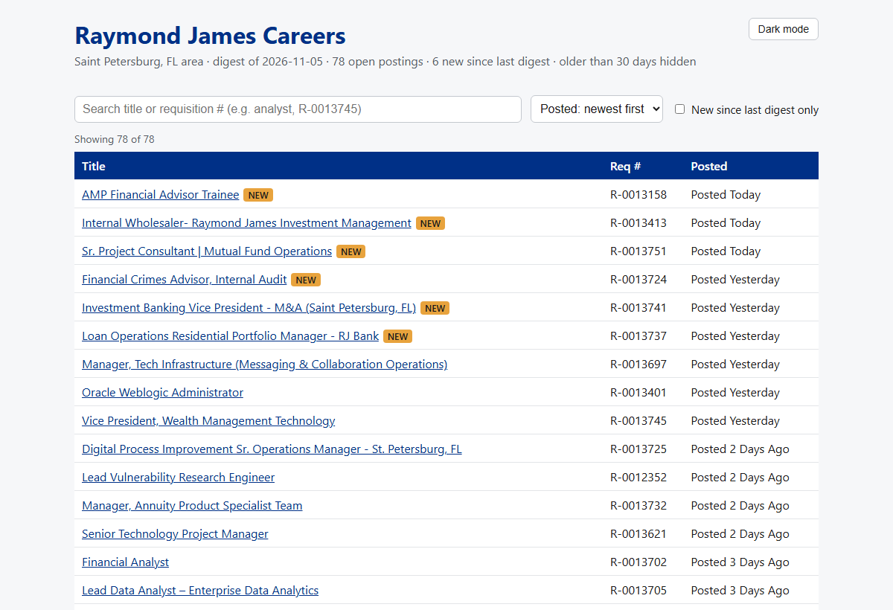
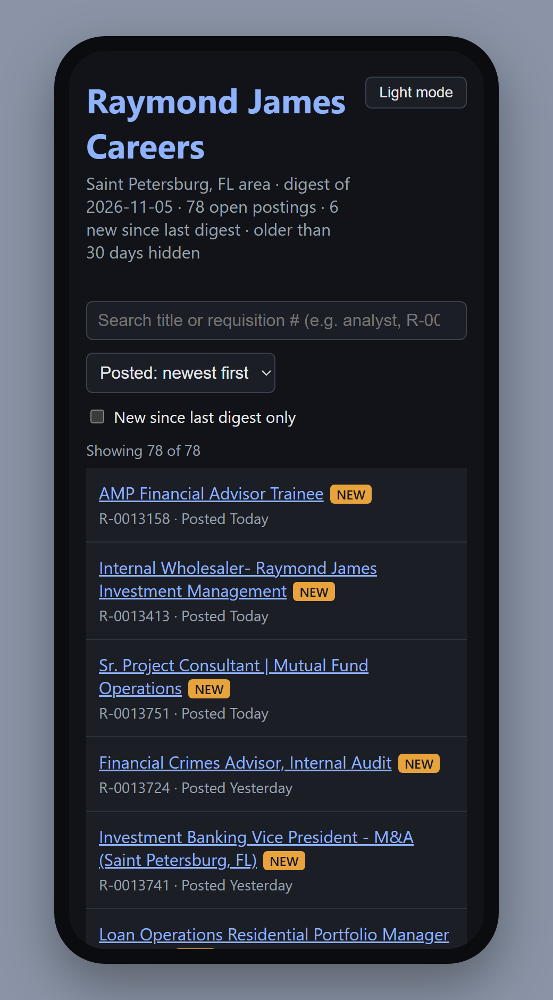

# RJ Job Tracker

**A serverless bot that watches the Raymond James job board for Saint Petersburg, FL and posts a twice-weekly digest to Discord, with a link to a searchable report page.**

Built with Python, GitHub Actions, GitHub Pages, Workday's job search API and Discord webhooks. It costs nothing to host.

**Live report:** [tanthai028.github.io/RJTracker](https://tanthai028.github.io/RJTracker/)



*The report page that each digest links to. New postings since the last digest are tagged NEW.*



*On a phone, in dark mode. Each job becomes a card.*

## Why I built it

I was job hunting at Raymond James, and their openings appear on a Workday board with no way to get notified about new ones. Postings fill on a rolling basis, so being one of the first applicants matters. Checking the page by hand was slow and easy to forget, so I automated it.

I set myself a few rules: it had to be free, it had to run without my laptop being on, and it shouldn't bury me in notifications.

## What it does

- **Every Monday and Thursday at 9 AM ET**, it pulls every listing within the board's Saint Petersburg, FL distance filter.
- **It skips stale postings.** Anything Workday labels "Posted 30+ Days Ago" is left out, since those roles are rarely still hiring.
- **It compares with the last digest** and finds the postings that are new since then.
- **It posts one short Discord message:** a link to the full list, the 5 newest postings, and a count of the rest. If nothing is new, it stays silent.
- **It publishes a report page** to GitHub Pages. You can search it by title or requisition number, sort it by posted date or title, and filter it to new postings only. You can star jobs to save them (kept in your browser) and show only saved ones. It has a light/dark toggle, a card layout on phones, a link to the exact Workday search it reads, and a link to run the workflow.
- **Removed postings drop off quietly.** No "this job closed" messages.

It has been running since June 2026, and the bot has committed 100+ state updates to this repo's history.

### Sending a digest on demand

The workflow can also be run by hand from **Actions → RJ Jobs Digest → Run workflow**, with a mode:

| Mode | What it does |
|---|---|
| `send` | Posts a digest now, even if nothing is new. The next scheduled digest only shows jobs after this one. |
| `resend` | Posts the last digest again, with an up-to-date report. Doesn't change saved state. |
| `report` | Rebuilds and republishes the report page only. Nothing is posted to Discord. |
| `weekly` | Same as a scheduled run: posts only if there are new jobs. |

## How it works

```
GitHub Actions cron (Mon + Thu)
        │
        ▼
check_jobs.py ──POST──▶ Workday's JSON search API
        │                (Saint Petersburg distance filter, paginated)
        ├── drop postings older than 30 days
        ├── diff against previous_jobs.json (keyed by requisition ID)
        ├── write docs/index.html + docs/reports/<date>.html
        └── save the Discord message to outbox.json
        │
        ▼
Workflow commits state + report ──▶ deploys docs/ to GitHub Pages
        │
        ▼
check_jobs.py --post-outbox ──▶ Discord webhook (link to the live report)
```

A few decisions worth explaining:

- **Calling the API instead of scraping HTML.** Workday pages render with JavaScript, so scraping the page would need a headless browser. Watching the browser's network tab showed the page loads its listings from a JSON endpoint. Calling that directly is faster, needs only `requests`, and doesn't break when the page layout changes. The location filter came from the same place: I copied the `appliedFacets` the page sends when you search near a ZIP code.
- **Workday only reports the total on the first page.** Later pages return `total: 0`, so the first version stopped after 40 of 137 jobs. The loop now remembers the first page's total.
- **A link instead of an attachment.** Discord shows an HTML attachment as a download, which is useless on a phone. Publishing the report to GitHub Pages turns it into a link that opens in the browser.
- **Deploy first, then post.** The digest waits in `outbox.json` until the Pages deploy finishes, so the link works the moment the message arrives.
- **The repo is the database.** GitHub Actions runners are thrown away after every run, so state has to live somewhere. The workflow commits `previous_jobs.json`, `last_digest.json` and the reports back to the repo. It's free, it's versioned, and the history doubles as a log of when each posting appeared.
- **Requisition IDs as keys.** Titles can be edited and reused, but a requisition number identifies one posting. Diffing on IDs avoids false "new posting" alerts.
- **The cron runs in UTC.** `0 13 * * 1,4` lands at 9 AM in summer and 8 AM in winter. That was simpler than writing daylight-saving logic for a job where an hour doesn't matter.
- **The webhook URL is a GitHub secret**, never in the code.

## What I learned

- **Look for the API before you scrape.** Spending ten minutes in DevTools turned a fragile, slow scraper into a few hundred lines of plain Python.
- **Serverless can be very simple.** A scheduled GitHub Action, GitHub Pages and a few JSON files covered scheduling, compute, storage, hosting and logging for free. Not everything needs a server or a database.
- **Alerts are only useful if they're quiet.** My first version messaged on every new posting and every removal. A short digest twice a week, with the details one tap away, is what I actually read.
- **Test on the device people will use.** Search worked on desktop but not on my phone: the phone card layout overrode the `hidden` attribute. Rebuilding the list from matching rows fixed it for every browser. I also learned iOS Safari zooms into any input with text smaller than 16px.

**What I'd do next:** make the board URL and location configurable so it can watch any Workday company, add retries for network failures, and add a test with a saved API response.

## Tech stack

- **Python 3.12** with `requests`
- **GitHub Actions** for scheduling (cron), running the script and deploying the report
- **GitHub Pages** for hosting the report page
- **Discord webhooks** with rich embeds for notifications
- **Workday's job search API** as the data source

## Run it yourself

<details>
<summary>Setup (about 5 minutes)</summary>

1. **Create a Discord webhook:** Server Settings → Integrations → Webhooks → New Webhook → Copy Webhook URL.
2. **Add it as a secret:** in your fork, Settings → Secrets and variables → Actions → New repository secret, named `DISCORD_WEBHOOK_URL`.
3. **Let the workflow commit:** Settings → Actions → General → Workflow permissions → **Read and write permissions**.
4. **Turn on Pages:** Settings → Pages → Build and deployment → Source → **GitHub Actions**. Then set `SITE_URL` in `check_jobs.py` to your Pages address.
5. **Test it:** Actions → RJ Jobs Digest → Run workflow → `send`. The first run treats every current listing as new; after that it only reports changes.

**Run locally:**

```bash
pip install -r requirements.txt
```

```bash
DISCORD_WEBHOOK_URL="https://discord.com/api/webhooks/..." python check_jobs.py --mode send
```

Locally the message posts straight away. The report is written to `docs/`, but its link only works once the site is deployed.

</details>

## Project structure

```
.github/workflows/check-jobs.yml   # Mon + Thu cron, manual modes, Pages deploy, then Discord post
check_jobs.py                      # Fetch, filter, diff, build report, notify
previous_jobs.json                 # Listings as of the last run (updated by the workflow)
last_digest.json                   # The last digest that had new jobs, for resend/report
docs/index.html                    # Latest report (published to GitHub Pages)
docs/reports/                      # One report per digest date
docs/screenshots/                  # Images used in this README
requirements.txt
```

## About

Built by **Tan Thai** during my own job search. | [Portfolio](https://tan-portfolio-taupe.vercel.app) | [LinkedIn](https://linkedin.com/in/tanthai028) | [GitHub](https://github.com/tanthai028)

Other projects: [Stride](https://github.com/tanthai028/stride-desktop-app) (desktop app for working through job applications), [yt-transcriber](https://github.com/tanthai028/yt-transcriber), [YTBookmarks](https://github.com/tanthai028/YTBookmark)
