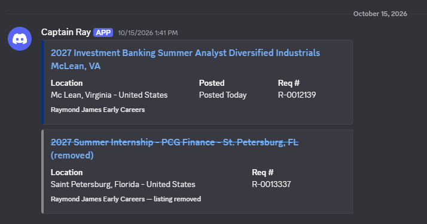

# RJ Job Tracker

**A serverless bot that watches the Raymond James Early Careers job board every day and pings Discord the moment a posting goes up or comes down.**

Python · GitHub Actions · Workday API · Discord webhooks · zero hosting cost



*A new posting (blue) and a removed one (grey, struck through), as they arrive in Discord.*

## Why I built it

I was recruiting for early-career roles at Raymond James, and their openings appear on a Workday board with no way to get notified about new ones. Early-career postings fill on a rolling basis, so being one of the first applicants matters. Checking the page by hand every day was slow and easy to forget, so I automated it.

I set myself a few rules: it had to be free, it had to run without my laptop being on, and it should only message me when something actually changed.

## What it does

- Every morning at 9 AM ET, it pulls every listing from the board.
- It compares them with yesterday's list.
- **New posting:** a Discord message with the title, location, posted date, requisition number and a direct apply link.
- **Removed posting:** a greyed-out, struck-through message, so I know a role has closed.
- **No change:** it stays silent. No daily "nothing new" noise.

It has been running daily since June 2026, and the bot has committed 80+ state updates to this repo's history.

## How it works

```
GitHub Actions cron (daily)
        │
        ▼
check_jobs.py ──POST──▶ Workday's JSON search API (paginated, 20 per page)
        │
        ├── diff against previous_jobs.json (keyed by requisition ID)
        ├── new / removed ──▶ Discord webhook embeds
        │
        ▼
Workflow commits the updated previous_jobs.json back to the repo
```

A few decisions worth explaining:

- **Calling the API instead of scraping HTML.** Workday pages render with JavaScript, so scraping the page would need a headless browser. Watching the browser's network tab showed the page loads its listings from a JSON endpoint. Calling that directly is faster, needs only `requests`, and doesn't break when the page layout changes.
- **The repo is the database.** GitHub Actions runners are thrown away after every run, so state has to live somewhere. Rather than adding a database, the workflow commits `previous_jobs.json` back to the repo. It's free, it's versioned, and the commit history doubles as a log of when each posting appeared.
- **Requisition IDs as keys.** Titles can be edited and reused across locations, but a requisition number identifies one posting. Diffing on IDs avoids false "new posting" alerts.
- **The cron runs in UTC.** `0 13 * * *` lands at 9 AM in summer and 8 AM in winter. That was simpler than writing daylight-saving logic for a job where an hour doesn't matter.
- **The webhook URL is a GitHub secret**, never in the code.

## What I learned

- **Look for the API before you scrape.** Spending ten minutes in DevTools turned a fragile, slow scraper into roughly 100 lines of plain Python.
- **Serverless can be very simple.** A scheduled GitHub Action plus a JSON file covered scheduling, compute, storage and logging for free. Not everything needs a server or a database.
- **Alerts are only useful if they're quiet.** The first version would have messaged every day. Only notifying on changes is what made me actually read the alerts.
- **Automating my own pain point was motivating.** It's a small project, but I use it every day, and it pushed me to learn GitHub Actions, workflow permissions and secrets management properly.

**What I'd do next:** make the board URL configurable so it can watch any Workday company, add retries for network failures, and add a test with a saved API response.

## Tech stack

- **Python 3.12** with `requests`
- **GitHub Actions** for scheduling (cron) and running the script
- **Discord webhooks** with rich embeds for notifications
- **Workday's job search API** as the data source

## Run it yourself

<details>
<summary>Setup (about 5 minutes)</summary>

1. **Create a Discord webhook:** Server Settings → Integrations → Webhooks → New Webhook → Copy Webhook URL.
2. **Add it as a secret:** in your fork, Settings → Secrets and variables → Actions → New repository secret, named `DISCORD_WEBHOOK_URL`.
3. **Let the workflow commit:** Settings → Actions → General → Workflow permissions → **Read and write permissions**.
4. **Test it:** Actions → Check RJ Early Careers Jobs → Run workflow. The first run treats every current listing as new; after that it only alerts on changes.

**Run locally:**

```bash
pip install -r requirements.txt
echo "[]" > previous_jobs.json   # simulate a first run
DISCORD_WEBHOOK_URL="https://discord.com/api/webhooks/..." python check_jobs.py
```

</details>

## Project structure

```
.github/workflows/check-jobs.yml   # Daily cron + manual trigger; commits state back
check_jobs.py                      # Fetch, diff, notify
previous_jobs.json                 # Last known listings (updated by the workflow)
requirements.txt
```

## About

Built by **Tan Thai** during my own early-career job search. | [LinkedIn](https://linkedin.com/in/tanthai028) | [GitHub](https://github.com/tanthai028)

Other projects: [Stride](https://github.com/tanthai028/stride-desktop-app) (desktop app for working through job applications) · [yt-transcriber](https://github.com/tanthai028/yt-transcriber) · [YTBookmarks](https://github.com/tanthai028/YTBookmark)
